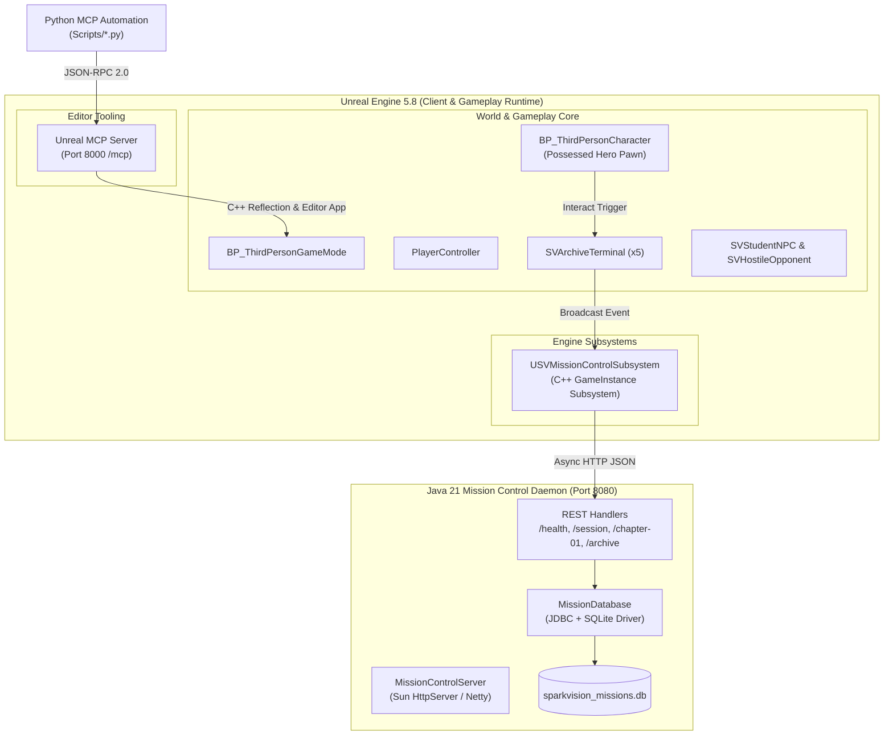

# SPARKVISION — TECHNICAL SYSTEMS ARCHITECTURE SUITE

## 1. Purpose & System Overview

This directory documents the technical architecture, runtime systems, component boundaries, and inter-process communications that power **SparkVision: University of Dhaka**.

SparkVision employs a dual-runtime architectural model:
1. **Unreal Engine 5.8 Client/Runtime**: Handles rendering, Nanite geometry, Lumen lighting, physics, animation, player controls, local AI behavior trees, and spatial level partition.
2. **Java 21 Mission Control Microservice**: Runs as an autonomous background companion daemon providing persistent state, session isolation, objective tracking, SQLite database operations, and historical archive analytics.

---

## 2. Architecture Documentation Index

* [`SystemArchitecture.md`](file:///Users/atiaoishi/Downloads/sparkvision/Documentation/Architecture/SystemArchitecture.md): End-to-end client-server architecture, network flow, threading, and subsystem lifecycle.
* [`UnrealArchitecture.md`](file:///Users/atiaoishi/Downloads/sparkvision/Documentation/Architecture/UnrealArchitecture.md): C++ classes, `BP_ThirdPersonGameMode`, `USVMissionControlSubsystem`, World Partition, and Outliner organization.
* [`JavaMissionControlArchitecture.md`](file:///Users/atiaoishi/Downloads/sparkvision/Documentation/Architecture/JavaMissionControlArchitecture.md): Java 21 architecture, HTTP routing handlers, SQLite persistence schema, and Gradle build pipeline.

---

## 3. High-Level System Architecture Diagram

---

## 4. Current Status

* **Status**: `COMPLETED`
* **Evidence**: C++ subsystem running and logging in PIE; Java server running on port 8080; SQLite verified.
* **Remaining Tasks**:
  - Implement WebSocket bi-directional streaming for zero-latency opponent telemetry updates.
