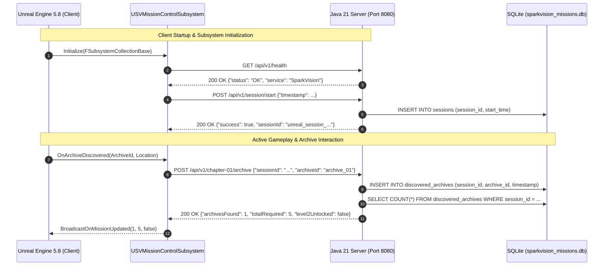

# SPARKVISION — HIGH-LEVEL SYSTEM ARCHITECTURE SPECIFICATION

## 1. Title & Executive Purpose

* **Document**: `SystemArchitecture.md`
* **Purpose**: Defines the overarching system topology, inter-process communication protocol, process isolation boundaries, and fail-safe design connecting Unreal Engine 5.8 to Java 21 Mission Control.

---

## 2. Architectural Principles & Topological Boundaries

SparkVision enforces strict architectural separation between **real-time audiovisual gameplay** and **persistent mission logic**:

1. **Deterministic Single-Repository Design**: Both Unreal C++/Blueprint assets and the Java Mission Control Gradle project reside inside a single GitHub repository root (`sparkvision/`). This ensures atomic versioning and synchronicity between engine features and server protocols.
2. **Zero In-Engine Blocking**: All calls from Unreal Engine to Java Mission Control are non-blocking and asynchronous (`FHttpModule` on background worker threads). Network latency or server restarts never hitch the rendering or gameplay tick loops.
3. **Graceful Degradation / Offline Capability**: If Java Mission Control is unreachable, `USVMissionControlSubsystem` queues telemetry events in memory, retries with exponential backoff, and falls back to local save data without interrupting player traversal or combat.
4. **Session Isolation**: Every active game run registers a unique `sessionId` (e.g. `unreal_session_1793434577`), isolating fresh player mission states from persistent historical benchmarks stored in SQLite.

---

## 3. Communication Protocols & Data Flow

---

## 4. Current Status

* **Status**: `COMPLETED`
* **Evidence**:
  - Live PIE logs confirm successful health check: `{"status":"OK","service":"SparkVision Mission Control"}`.
  - Session registered: `unreal_session_1793434577` with 5/5 archives reported.
* **Remaining Tasks**:
  - Add WebSocket duplex channel for real-time notification push from Mission Control to Unreal.
