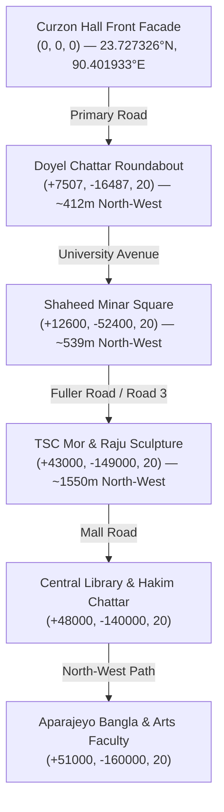

# SPARKVISION — CAMPUS GEOGRAPHY, LANDMARKS & MASTERPLAN SUITE

## 1. Purpose & Scope

This directory contains the geospatial, architectural, and environmental specifications governing the recreation of the **University of Dhaka (DU)** campus in **Unreal Engine 5.8**.

The documentation here ensures that every road, building footprint, courtyard, monument, and boundary corresponds accurately to metric ground truth ($1\text{ Unreal Unit} = 1\text{ cm}$) anchored to verified WGS 84 / UTM Zone 46N cartographic coordinates.

---

## 2. Directory Index

* [`CampusMasterplan.md`](file:///Users/atiaoishi/Downloads/sparkvision/Documentation/Campus/CampusMasterplan.md): The master blockout plan, campus zones (A, B, C, D), road network, and scale definitions.
* [`GeographicValidation.md`](file:///Users/atiaoishi/Downloads/sparkvision/Documentation/Campus/GeographicValidation.md): Mathematical audit and geodetic reprojection methodology from EPSG:4326 to UTM Zone 46N (EPSG:32646).
* [`LandmarkRegister.md`](file:///Users/atiaoishi/Downloads/sparkvision/Documentation/Campus/LandmarkRegister.md): Definitive registry of all modeled campus landmarks, GPS anchors, Unreal coordinates, dimensions, and mesh assets.
* [`CurzonHall_Architecture.md`](file:///Users/atiaoishi/Downloads/sparkvision/Documentation/Campus/CurzonHall_Architecture.md): Architectural report on the Phase 2 Curzon Hall modular hero construction, materials, and cinematic environment.

---

## 3. High-Level Spatial Layout & Anchor

* **Primary Coordinate Anchor (Origin `(0, 0, 0)`)**: Center of the southern front facade of **Curzon Hall** (`23.727326° N, 90.401933° E`).
* **Axis Orientation**:
  - `+X = North` (towards Doyel Chattar, Shaheed Minar, and Shahbagh)
  - `+Y = East` (towards High Court and Supreme Court grounds)
  - `+Z = Up` (elevation in centimeters above campus base grade)

---

## 4. Current Status

* **Status**: `COMPLETED`
* **Evidence**:
  - `TopDown_Campus_Corrected_UTM46N.png` visualizes all 7 major landmarks aligned along the authentic road network.
  - Curzon Hall modular architecture fully assembled and verified in PIE (`PIE_Live_Gameplay_Verified.png`).
* **Remaining Tasks**:
  - Ingest secondary departmental wings (Chemistry, Physics, Zoology) into `LandmarkRegister.md`.
