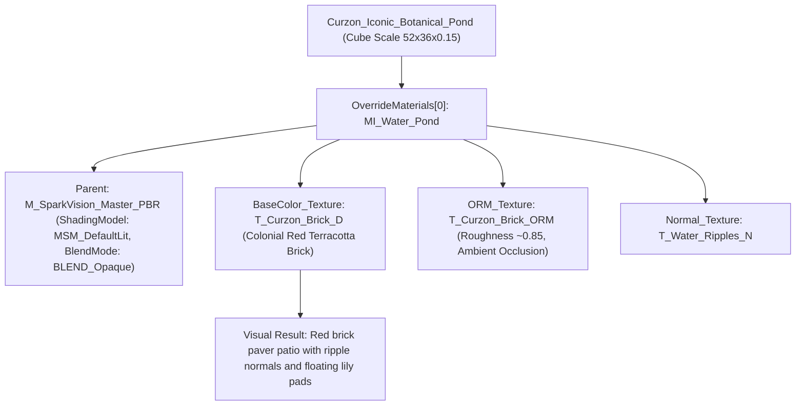

# SPARKVISION — CURZON HALL POND INITIAL AUDIT & ROOT CAUSE ANALYSIS
## Level 01: Compact Campus (`LV_Level01_Compact_Campus`) | Unreal Engine 5.8 (Metal / Apple Silicon M4)

---

### 1. Executive Summary

During environmental inspection of the Curzon Hall precinct in Level 1 (`LV_Level01_Compact_Campus`), the Curzon Botanical Pond exhibited an incorrect, dry architectural appearance resembling colonial red brick pavers rather than natural, calm freshwater.

A deep technical audit of the active level, actor components, mesh definitions, and material instance parameters was conducted via Unreal Editor diagnostics and MCP runtime inspection. This document records the empirical root cause, architectural geometry analysis, and the required reconstruction roadmap.

---

### 2. Verified Active Level & Actor Identification

* **Active Playable Map**: `/Game/SparkVision/Maps/Level01/LV_Level01_Compact_Campus`
* **Target Pond Actor**:
  * **Actor Label**: `Curzon_Iconic_Botanical_Pond`
  * **Actor Reference**: `/Game/SparkVision/Maps/Level01/LV_Level01_Compact_Campus.LV_Level01_Compact_Campus:PersistentLevel.StaticMeshActor_UAID_685EDD40918A671003_1769599862`
  * **Component**: `StaticMeshComponent0`
  * **World Transform**:
    * **Location**: `X = 4800.0, Y = 0.0, Z = 7.0`
    * **Rotation**: `Pitch = 0.0, Yaw = 0.0, Roll = 0.0`
    * **Scale**: `X = 52.0, Y = 36.0, Z = 0.15`
  * **Computed World Bounds**:
    * $X \in [2200.0, 7400.0]\text{ cm}$ (Length = $52.0\text{ m}$)
    * $Y \in [-1800.0, +1800.0]\text{ cm}$ (Width = $36.0\text{ m}$)
    * $Z \in [-0.5, +14.5]\text{ cm}$ (Water surface elevation = $Z = 14.5\text{ cm}$)

---

### 3. Empirical Root Cause Identification

Through programmatic asset and component inspection via `ObjectTools` and `MaterialInstanceTools`, three catastrophic issues were identified that combined to cause the pond's brick-like appearance:

#### Defect A: Colonial Red Brick Textures Assigned to Water Material Instance
Inspection of `MI_Water_Pond` parameters yielded:
* `BaseColor_Texture`: `/Game/SparkVision/Textures/T_Curzon_Brick_D.T_Curzon_Brick_D` (Red terracotta architectural brick texture).
* `ORM_Texture`: `/Game/SparkVision/Textures/T_Curzon_Brick_ORM.T_Curzon_Brick_ORM` (Brick mortar lines, high surface roughness).
* `Normal_Texture`: `/Game/SparkVision/Textures/T_Water_Ripples_N.T_Water_Ripples_N`.

*Root Cause*: During automated material batching in earlier campus passes, `T_Curzon_Brick_D` and `T_Curzon_Brick_ORM` were mistakenly assigned as the default base color and roughness textures to `MI_Water_Pond`, turning the entire surface into red brick paving with wavy normal reflections.

#### Defect B: Opaque DefaultLit Shading Model
Inspection of `MI_Water_Pond`'s parent material (`/Game/SparkVision/Materials/M_SparkVision_Master_PBR`):
* `ShadingModel`: `MSM_DefaultLit`
* `BlendMode`: `BLEND_Opaque`

*Impact*: The material had zero light transmission, zero depth attenuation, zero water scattering/absorption, and zero subsurface depth fade. It rendered as a completely solid opaque geometric slab.

#### Defect C: Geometry & Basin Disconnect
* **Water Mesh**: `/Engine/BasicShapes/Cube.Cube` flattened to 15 cm thickness.
* **Underlying Ground**: `Curzon_Botanical_Plaza_Ground` at `Z = 0.0` with scale $Z = 0.15$ (top surface at $Z = 7.5\text{ cm}$).
* The water cube sat directly on the grass ground with only 7 cm effective clearance between the ground surface ($Z = 7.5$) and the water top ($Z = 14.5$).
* There was no recessed basin or dark submerged silt bed, causing any translucent or transparent shader attempt to reveal the flat green lawn underneath.

---

### 4. Associated Pond Environment & Actors Audit

Inspection of adjacent folders in the level revealed:

| Folder / Category | Actor Name | Asset Reference | World Location | Observations |
| :--- | :--- | :--- | :--- | :--- |
| `Pond_Architecture` | `Curzon_Pond_MainGhat` | `SM_Curzon_Pond_Ghat` | `(2350, 0, 20)` | Stepped red-brick colonial ghat. Steps lead down toward the water plane ($X = 2350$). Bottom steps properly touch water line at $Z \approx 14.5$. |
| `Aquatic_Flora` | `CurzonPond_WaterLily_1..8` | `SM_Pond_WaterLily_WWM` | `(3400..6600, -800..700, 14.0)` | Authentic Nymphaea nouchali clusters. Resting at $Z = 14.0$, which is flush with water top ($Z = 14.5$). |
| `Undergrowth` | `CurzonPond_Undergrowth_01..15` | `SM_Fern_Undergrowth_Cluster` | Riparian periphery ($Z = 20.0$) | Bank undergrowth correctly positioned along shorelines. |
| `Riparian Trees` | `SM_Tree_Krishnachura_WWM`, `SM_Tree_Debdaru_Columnar` | Varied | Surrounding perimeter | Overhanging branches create dramatic reflection opportunities. |

---

### 5. Technical Reconstruction Requirements

To resolve the issue according to AAA standards on Apple Silicon M4:
1. **Single Layer Water Master Shader (`M_CurzonPond_Water`)**:
   * Implement native Unreal Engine 5.8 `SingleLayerWater` shading model (`MSM_SingleLayerWater`).
   * Blend Mode: `BLEND_Opaque` (as required by SingleLayerWater).
   * Integrate `MaterialExpressionSingleLayerWaterMaterialOutput`:
     * `ScatteringCoefficients`: Calibrated for freshwater botanical pond (`(0.02, 0.08, 0.05)` 1/cm).
     * `AbsorptionCoefficients`: Natural depth absorption (`(0.12, 0.06, 0.03)` 1/cm).
     * `PhaseG`: Subtle forward scattering ($0.10$).
     * `ColorScaleBehindWater`: Clean scene transmittance.
   * Dual Panning Micro-Ripples using `T_Water_Ripples_N` with distinct UV scales and speeds ($0.015$ and $-0.025$).
   * Calibrated Specular Roughness ($0.08 - 0.15$) for clear, serene campus sky and Curzon Hall architectural reflections.
2. **Dedicated Basin and Shoreline Bed**:
   * Construct a dedicated dark submerged basin bed underneath the water plane ($Z = -40\text{ cm}$ to $Z = 5\text{ cm}$) with deep river silt / algae mud material, ensuring natural depth gradation.
   * Ensure stone/brick perimeter coping frames the pond cleanly so water laps against the ghat and borders without polygon gaps or overflowing onto lawns.
3. **Pond Water Surface Mesh**:
   * Clean planar water surface actor fitting inside the perimeter ($X \in [2320, 7400], Y \in [-1800, +1800]$).
   * Level calibrated to $Z = 14.0\text{ cm}$ so water lilies float naturally on the meniscus and the lowest 2 ghat steps are submerged.
4. **Performance & Memory Guard on M4**:
   * Avoid expensive Planar Reflection render targets or real-time fluid simulation.
   * Rely on Lumen screen-space / distance-field reflections and Single Layer Water's single-pass forward shading.

---
*Audit completed on active level `LV_Level01_Compact_Campus` at commit `9f86292`.*
