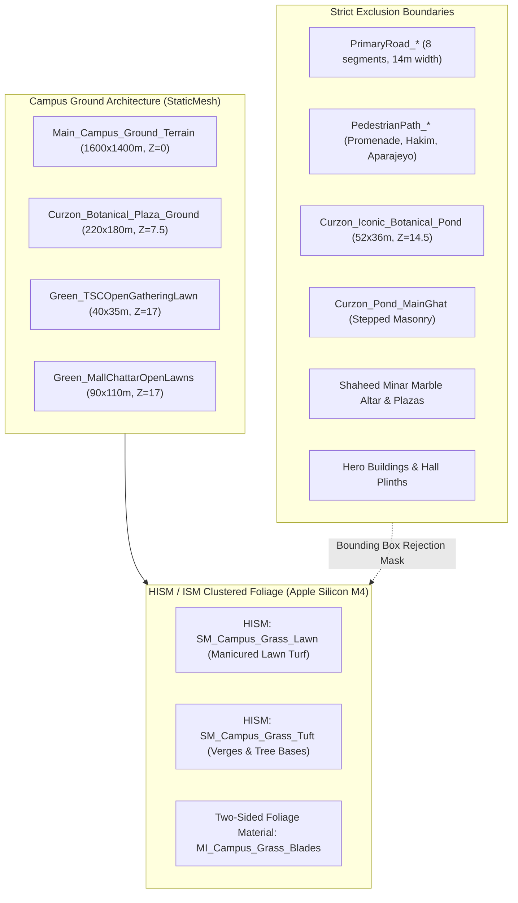

# SPARKVISION — COMPLETE CAMPUS GROUND SURFACE AUDIT & CLASSIFICATION REGISTER
## University of Dhaka Campus Ground Architecture | Unreal Engine 5.8 (Metal / Apple Silicon M4)
### Active Map: `LV_Level01_Compact_Campus` (and Reference `LV_Campus_Blockout`)

---

## 1. Executive Summary & Geometry System Determination

A programmatic audit across the University of Dhaka digital twin in Unreal Engine 5.8 was conducted via MCP runtime reflection and asset metadata inspection.

### Fundamental Geometry System Finding:
* **Unreal Landscape Status**: **0 Landscape Actors** and **0 LandscapeStreamingProxies** are present in the level.
* **Surface Architecture**: 100% of the campus ground, terrain plates, manicured lawn sectors, pedestrian plazas, and roadways are implemented via **StaticMeshActors** (specifically parameterized static meshes and planar bounding shapes with calibrated PBR materials).
* **Grass Implementation Path**: Because the campus does not use the Unreal Landscape system, native **Landscape Grass Output (`UGrassType`)** cannot be applied directly to Landscape layers. Instead, grass coverage is executed via **Hierarchical Instanced Static Mesh (HISM) / Instanced Static Mesh (ISM)** clusters and **Foliage Type** instanced rendering. This provides zero per-blade actor overhead, GPU-driven hardware instancing, and distance culling optimized specifically for Apple Silicon M4 (16 GB unified memory).

---

## 2. Campus Ground Surface Inventory & 12-Class Classification Register

Every surface in the active level has been audited, mapped to world coordinates, and categorized into the 12 required architectural classes:

| # | Surface Classification | Primary Actors / Components | World Coordinates $(X, Y, Z)$ | Dimensions / Extents | Underlying Mesh & Material | Grass Treatment & Placement Rule |
| :- | :--- | :--- | :--- | :--- | :--- | :--- |
| **1** | **Grass-Eligible Open Lawn** | `Curzon_Botanical_Plaza_Ground` (Front Parterres & Flanks), `Green_TSCOpenGatheringLawn`, `Green_MallChattarOpenLawns` | `Curzon: (0, 0, 0)` `TSC: (61500, -63000, 12)` `Mall: (69000, -88000, 12)` | Curzon: $220\text{m} \times 180\text{m}$ TSC: $40\text{m} \times 35\text{m}$ Mall: $90\text{m} \times 110\text{m}$ | `Cube.Cube` `MI_Ground_Grass` | **Primary Lawn Treatment**: Dense, manicured short lawn grass (`SM_Campus_Grass_Lawn`, $12 - 16\text{ cm}$). Subtle color variations, high coverage. Zero obstruction to sightlines. |
| **2** | **Grass-Eligible Exposed Soil** | `Main_Campus_Ground_Terrain` (Inter-sector open fields, unpaved verges, campus peripheries) | `(35000, -50000, -10)` | $1600\text{m} \times 1400\text{m}$ ($1.6\text{km} \times 1.4\text{km}$) | `Cube.Cube` `MI_Ground_Grass` | **Natural Open Turf Treatment**: Medium-density short and tufted grass (`SM_Campus_Grass_Tuft`, $20 - 28\text{ cm}$), interspersed with soil patches and leaf litter. |
| **3** | **Garden Beds & Parterres** | `Flowerbed_TSC_Raju_Plaza`, `Flowerbed_Doyel_Plaza_North/South`, `Flowerbed_CentralLibrary_Front`, `Flowerbed_Shahidullah_Quad`, `Flowerbed_Shaheed_Garden_Left/Right`, `Flowerbed_KalaBhaban_Garden`, `Flowerbed_TSC_Cafeteria_Lawn` | Varied landmark plazas ($Z = 20.0$) | Circular & rectilinear radial beds ($\approx 6\text{m} - 12\text{m}$ radius) | `SM_Garden_Flowerbed_Circular` `MI_Curzon_StonePaving` / Soil | **Ornamental Ground Cover**: Low groundcover, flowering Kamini / Rangan shrubs, surrounded by rich moist garden loam with small edge tufts. |
| **4** | **Tree-Base Soil & Root Zones** | `Curzon_Litter_Patch_1`, `TheMall_Banyan1_Litter`, `TheMall_Banyan2_Litter`, `HakimChattar_Litter_1`, `Fuller_Litter_Patch_1..2` | Beneath Banyan, Krishnachura, and Raintree canopies ($Z = 20.0$) | $2.2\text{m} - 5.0\text{m}$ radial zones around major trunks | `SM_Ground_LeafLitter_Patch` `MI_Ground_LeafLitter_Moist` | **Root Apron Treatment**: Shaded organic soil loam with fallen leaf litter decals; tufted verge grass feathering outward at $0.8\text{m} - 1.5\text{m}$ radius. Trunk base kept clear. |
| **5** | **Road Surfaces** | `PrimaryRoad_Curzon_To_DoyelChattar`, `PrimaryRoad_FullerRoad_To_ShaheedMinar`, `PrimaryRoad_TSCMor_RajuPlaza`, `PrimaryRoad_NazrulAve_TSC_To_Library`, `PrimaryRoad_NazrulAve_Library_To_Shahbagh`, `PrimaryRoad_MallRoad_To_ArtsFaculty`, `PrimaryRoad_UniversityAve_Segment1..2` | Spanning major campus avenues ($Z = 6.0$) | Width $= 14.0\text{m}$, Lengths $= 140\text{m} - 610\text{m}$ | `Cube.Cube` `MI_Primary_Road` | **STRICT EXCLUSION ZONE**: Zero grass instances. Minimum $25\text{ cm}$ exclusion buffer from road boundary edges. |
| **6** | **Sidewalks & Footpaths** | `PedestrianPath_Curzon_SouthPromenade`, `PedestrianPath_HakimChattar_Hub`, `Border_Library_Walkway_1`, `Border_FullerRoad_Verge_1` | Adjacent to roadways and plazas ($Z = 8.0$) | Width $= 2.5\text{m} - 10.0\text{m}$ | `Cube.Cube` `MI_Pedestrian_Path` | **STRICT EXCLUSION ZONE**: Paved walkway surfaces excluded; narrow low-profile grass fringe allowed along earthen curb interfaces. |
| **7** | **Courtyards & Plazas** | `TSC_Cafeteria_CourtyardRing`, `PedestrianPlaza_ShaheedMinar_MarbleAltar`, `PedestrianPath_AparajeyoBangla_Plaza` | TSC: `(21000, -19500, 20)` Shaheed Minar: `(-1273, -53973, 20)` Aparajeyo: `(73486, -95794, 8)` | Plaza extents $= 30\text{m} - 60\text{m}$ | `Cube.Cube` `MI_Shaheed_Marble`, `MI_Curzon_StonePaving` | **STRICT EXCLUSION ZONE**: Historic marble altar, brick terraces, and paved gathering squares remain pristine. |
| **8** | **Building Foundations & Plinths** | `Hero_Curzon_Hall`, `Hero_DrShahidullah_Hall`, `Hero_SalimullahMuslim_Hall`, `Hero_Rokeya_Hall`, `Hero_TSC_AuditoriumComplex`, `Hero_CentralLibrary_Building`, `Hero_DU_CentralMosque`, `ArtsFaculty_KalaBhaban_AcademicBlock` | Major campus sectors ($Z = 20.0$) | Architectural footprints | Complex Modular / Landmark meshes | **STRICT EXCLUSION ZONE**: Minimum $35\text{ cm}$ exclusion apron around all building footprints to prevent mesh penetration into brick plinths. |
| **9** | **Stairs, Verandas & Ramps** | `Curzon_Hero_VerandaLower_W1..W6`, `Curzon_Hero_VerandaLower_E1..E6`, `Curzon_Hero_EntrancePortal`, `Curzon_Main_Gate_Stairs` | Curzon Hall facade ($Z = 10.0 - 25.0$) | Stepped architectural elevations | `SM_Curzon_Veranda_Lower_PBR` `MI_Curzon_Sandstone` | **STRICT EXCLUSION ZONE**: 100% geometric clearance. |
| **10** | **Pond Water Surface** | `Curzon_Iconic_Botanical_Pond` | `(4800, 0, 7)` | $52.0\text{m} \times 36.0\text{m}$, Water plane $Z = 14.5$ | `Cube.Cube` `MI_CurzonPond_Water` | **STRICT EXCLUSION ZONE**: Water volume completely excluded from terrestrial grass instances. (Reserved for aquatic flora `SM_Pond_WaterLily_Cluster`). |
| **11** | **Pond Ghat & Shoreline Paving** | `Curzon_Pond_MainGhat`, `Curzon_Pond_Submerged_Basin` | Ghat: `(2350, 0, 20)` Basin: `(4800, 0, -25)` | Ghat: $13.2\text{m} \times 4.25\text{m}$ ($X \in [1690, 3010]$) Basin: $52\text{m} \times 36\text{m}$ | `SM_Curzon_Pond_Ghat` `MI_Curzon_StonePaving` | **STRICT EXCLUSION ZONE**: Terracotta stepped tiers and coping stones must remain clean; shoreline soil transitions apply only along natural earthen perimeter banks. |
| **12** | **Other Non-Grass Surfaces** | `Boundary_Wall_East_HighCourt`, `Boundary_Wall_South_Nimtoli`, `Boundary_Wall_West_Nilkhet`, `Boundary_Wall_North_Shahbagh`, `Hero_DoyelChattar_Monument`, `Hero_ShaheedMinar_Monument`, `Hero_AparajeyoBangla_Sculpture` | Campus bounding borders ($Z = 20.0$) | Walls: $180\text{m} - 360\text{m}$ span | Boundary & Sculpture Meshes | **STRICT EXCLUSION ZONE**: Retaining walls, perimeter fences, and bronze/stone sculptures. |

---

## 3. Recommended Grass Treatment by Region

### Region A: Curzon Hall Front Quadrangle & Parterres
* **Surface Bounds**: $X \in [-10000, 1400], Y \in [-9000, 9000], Z \approx 7.5\text{ cm}$
* **Target Character**: Iconic British colonial manicured university lawn.
* **Prescribed Meshes**: `SM_Campus_Grass_Lawn` (Scale $0.85 - 1.15$, height $12 - 16\text{ cm}$).
* **Density**: Moderate-dense ($12 - 18\text{ instances/m}^2$) arranged around colonial streetlamps, benches, and parterre hedges, with zero penetration into paved pathways.

### Region B: Curzon Botanical Pond Periphery & Wetland Banks
* **Surface Bounds**: $X \in [1400, 7500], Y \in [-2000, 2000], Z \approx 14.5 - 20.0\text{ cm}$
* **Target Character**: Natural riparian deltaic bank with soft grass-to-silt transition.
* **Prescribed Meshes**: Mixture of `SM_Campus_Grass_Tuft` ($18 - 25\text{ cm}$) and `SM_Grass_Tall_Savanna` (reeds), surrounding Banyan and Krishnachura root zones.
* **Exclusion**: Strict clipping at water boundary ($X \in [2200, 7400], Y \in [-1800, 1800]$) and Ghat structure ($X \in [1690, 3010], Y \in [-400, 25]$).

### Region C: The Mall & Arts Faculty (Kala Bhaban) Lawns
* **Surface Bounds**: $X \in [65000, 75000], Y \in [-95000, -82000], Z \approx 12.0 - 17.0\text{ cm}$
* **Target Character**: Expansive, open tropical campus gathering lawn beneath massive heritage Banyan canopies.
* **Prescribed Meshes**: `SM_Campus_Grass_Lawn` with scattered `SM_Campus_Grass_Tuft` near tree bases and flowerbed margins.

### Region D: TSC & Raju Memorial Green Gathering Lawn
* **Surface Bounds**: $X \in [59000, 64000], Y \in [-65000, -61000], Z \approx 12.0 - 17.0\text{ cm}$
* **Target Character**: Welcoming, open student union lawn fringed by Royal Palms and Krishnachura trees.
* **Prescribed Meshes**: `SM_Campus_Grass_Lawn` ($14 - 18\text{ cm}$), clear of Raju Memorial sculpture plinth and cafeteria courtyard.

### Region E: Inter-Landmark Roadside Verges (Fuller Road, University Ave, Nazrul Ave)
* **Surface Bounds**: Along linear road corridors ($Z \approx 6.0 - 15.0\text{ cm}$)
* **Target Character**: Natural roadside verge grass with soil transition.
* **Prescribed Meshes**: Controlled `SM_Campus_Grass_Tuft` strips strictly offset $30\text{ cm} - 150\text{ cm}$ from the asphalt edge.

---

## 4. Technical Implementation Architecture

1. **Instantiation Engine**: `HierarchicalInstancedStaticMeshComponent` (HISM) grouped per campus sector to maintain localized frustum culling.
2. **Material Optimization**: `MI_Campus_Grass_Blades` parented to `M_Master_NaturalFoliage` (`MSM_TwoSidedFoliage`, `BLEND_Masked`) utilizing texture atlas `T_Campus_Grass_Blades_D` and `T_Campus_Grass_Blades_N`.
3. **Culling Distances**:
   * Lawn grass: Cull start $= 3,500\text{ cm}$ ($35\text{ m}$), Cull end $= 7,000\text{ cm}$ ($70\text{ m}$).
   * Medium tufts: Cull start $= 4,500\text{ cm}$ ($45\text{ m}$), Cull end $= 9,000\text{ cm}$ ($90\text{ m}$).
   * Shadows disabled on distant LODs to preserve M4 GPU bandwidth.
