# SPARKVISION — COMPLETE UNIVERSITY OF DHAKA WORLD DEVELOPMENT SPECIFICATION

## 1. Executive Vision & Benchmark Alignment

**SparkVision** unites two core creative pillars:
1. **Visual & Atmospheric Benchmark**: *Where Winds Meet* (燕云十六声) — cinematic environmental composition, dynamic lighting depth, natural wind-swept foliage, authentic physical materials, grounded scale, and seamless spatial storytelling.
2. **Geographic & Cultural Foundation**: The authentic, real-world **University of Dhaka (DU)** campus in Bangladesh (1.6 km × 1.4 km).

This document governs the full, autonomous development of the entire University of Dhaka campus in Unreal Engine 5.8 within `LV_Campus_Blockout.umap`, ensuring **zero primitive colored blockouts remain for any major building or sector**.

---

## 2. Hardware Budget & Technical Constraints (MacBook Air M4, 16 GB RAM)

To guarantee flawless runtime performance and prevent memory pressure:
* **Geometry Target**: Maximum 15,000–35,000 triangles per building cluster, modular kit reusability.
* **Draw Calls**: Kept under 1,200 total per frame through instancing and material sharing.
* **Material Footprint**: Shared PBR material instances (`MI_Curzon_Brick`, `MI_Hero_Modern`, `MI_Shaheed_Marble`, `MI_Curzon_StonePaving`, `MI_Primary_Road`, `MI_Ground_Grass`).
* **Lighting**: Software Lumen Mesh SDFs (`r.Lumen.HardwareRayTracing=0`, `r.RayTracing=0`, `r.PathTracing=0`).
* **Texture Streaming Pool**: Clamped to 1,000 MB (`r.Streaming.PoolSize=1000`).

---

## 3. Full Campus Sector & Architectural Blueprint

The 1.6 km × 1.4 km campus footprint is structured into six comprehensive architectural sectors:

```mermaid
flowchart TD
    subgraph S1 ["Sector 1: Curzon & Science Precinct"]
        Curzon["Curzon Hall Hero Complex\n(Indo-Saracenic 1904)"]
        BotanicalPond["Curzon Botanical Pond"]
        SciLabs["Physics & Chemistry Annexes"]
        Shahidullah["Dr. Muhammad Shahidullah Hall"]
        FH["Fazlul Huq Muslim Hall"]
    end

    subgraph S2 ["Sector 2: University Avenue & Doyel Chattar"]
        Doyel["Doyel Chattar Roundabout\n(National Bird Monument)"]
        BanglaAcad["Bangla Academy Complex\n(Burdwan House)"]
        Suhrawardy["Suhrawardy Udyan Tree Canopy"]
        IBA["IBA Building Complex"]
    end

    subgraph S3 ["Sector 3: Memorial & Medical Corridor"]
        ShaheedMinar["Central Shaheed Minar Plaza\n(1952 Language Movement)"]
        FullerRoad["Fuller Road Corridor"]
        SMHall["Salimullah Muslim (SM) Hall\n(1931 Indo-Saracenic Quad)"]
        Jagannath["Jagannath Hall Quadrangle"]
        Rokeya["Rokeya Hall Complex"]
    end

    subgraph S4 ["Sector 4: TSC & Central Library Precinct"]
        TSC["Teacher-Student Centre (TSC)\n(Doxiadis Modernism)"]
        Raju["Raju Memorial Sculpture\n(Anti-Terrorism Monument)"]
        Hakim["Hakim Chattar Outdoor Hub"]
        Library["DU Central Library\n(Muzharul Islam 1953)"]
        Mosque["DU Central Mosque\n(Classical Dome & Minaret)"]
        Nazrul["Poet Kazi Nazrul Islam Mausoleum"]
    end

    subgraph S5 ["Sector 5: Arts & Social Sciences Precinct"]
        MallRoad["Mall Road Grand Corridor"]
        KalaBhaban["Arts Faculty (Kala Bhaban)\n(Modernist Brise-Soleil 160m)"]
        Aparajeyo["Aparajeyo Bangla Sculpture\n(1979 Freedom Fighters)"]
        SocialSci["Social Sciences & Registrar Bhaban"]
        SurjaSen["Surja Sen & Mohsin Halls"]
        SNahar["Shamsun Nahar Hall"]
    end

    subgraph S6 ["Sector 6: Peripheral Skyline & Boundaries"]
        NorthSky["Shahbagh Urban Skyline"]
        EastSky["High Court & Ramna Mughal Backdrop"]
        WestSky["Nilkhet Educational Market Border"]
        SouthSky["Old Dhaka Historical Rooftops"]
        Walls["Campus Heritage Boundary Railings"]
    end

    S1 --> S2 --> S4 --> S5
    S1 --> S3 --> S4
    S5 --> S6
```

---

## 4. Landmark Master Catalog & Coordinates (UTM Zone 46N Audited)

| Sector | ID | Landmark / Structure | Style / Archetype | Unreal Location (X, Y, Z cm) | Dimensions (m) | Mesh Asset Path |
| :--- | :--- | :--- | :--- | :--- | :---: | :--- |
| **S1** | LM-01 | Curzon Hall Complex | Indo-Saracenic Revival | `(-2500, 0, 0)` | 120 × 50 × 25 | Modular Kit (`SM_Curzon_*`) |
| **S1** | LM-02 | Curzon Botanical Pond | Formal Water Basin | `(4800, 0, -30)` | 55 × 40 × 3 | Level Geometry + Water Plane |
| **S1** | LM-03 | Curzon Science Annexes | Indo-Saracenic 2-Storey | `(6500, 2500, 20)` | 80 × 35 × 14 | `SM_Curzon_ScienceAnnex` |
| **S1** | LM-04 | Dr. M. Shahidullah Hall | Colonial Red Brick Quad | `(5000, -5000, 20)` | 90 × 70 × 16 | `SM_Shahidullah_Hall` |
| **S2** | LM-05 | Doyel Chattar Roundabout | Folk Art Magpie Monument | `(7507, -16487, 20)` | 18 dia × 9 ht | `SM_DoyelMonument` |
| **S2** | LM-06 | Bangla Academy Complex | Colonial + Modern Hall | `(18000, -28000, 20)` | 85 × 55 × 16 | `SM_BanglaAcademy` |
| **S2** | LM-07 | IBA Building Complex | Red Brick Modernist | `(53000, -52000, 20)` | 65 × 40 × 15 | `SM_IBA_Building` |
| **S3** | LM-08 | Central Shaheed Minar | Modernist Memorial Altar | `(-282, -54042, 20)` | 40 × 30 × 14 | `SM_ShaheedMinar_Monument` |
| **S3** | LM-09 | Salimullah Muslim (SM) Hall | 1931 Indo-Saracenic Quad | `(15000, -68000, 20)` | 110 × 85 × 18 | `SM_SalimullahMuslim_Hall` |
| **S3** | LM-10 | Jagannath Hall Complex | Heritage Red Brick Quad | `(20000, -55000, 20)` | 95 × 75 × 16 | `SM_Jagannath_Hall` |
| **S3** | LM-11 | Rokeya Hall Complex | Colonial Red Brick Wings | `(42000, -66000, 20)` | 85 × 60 × 15 | `SM_Rokeya_Hall` |
| **S4** | LM-12 | Teacher-Student Centre (TSC)| Doxiadis Modernism | `(61200, -59500, 20)` | 54 × 44 × 15.2 | `SM_TSC_Building` |
| **S4** | LM-13 | Raju Memorial Sculpture | Anti-Terrorism Bronze Unity| `(58964, -63725, 20)` | 14 dia × 9.95 | `SM_RajuSculpture` |
| **S4** | LM-14 | DU Central Library | Muzharul Islam Modernism | `(73459, -71699, 20)` | 80 × 50 × 18 | `SM_CentralLibrary` |
| **S4** | LM-15 | DU Central Mosque | Classical Islamic Dome | `(82582, -72180, 20)` | 50 × 40 × 26 | `SM_CentralMosque` |
| **S4** | LM-16 | Kazi Nazrul Mausoleum | Open Marble Cenotaph | `(87224, -71761, 120)` | 16 × 12 × 4.5 | `SM_NazrulMausoleum` |
| **S5** | LM-17 | Arts Faculty (Kala Bhaban) | Modernist Brise-Soleil | `(76500, -95794, 20)` | 160 × 50 × 24 | `SM_KalaBhaban` |
| **S5** | LM-18 | Aparajeyo Bangla Sculpture| 1979 Freedom Fighters | `(73486, -95794, 20)` | 8 × 8 × 9.5 | `SM_AparajeyoBangla` |
| **S5** | LM-19 | Registrar Administrative Block| 4-Storey Modernist Block | `(66000, -78000, 20)` | 75 × 45 × 16 | `SM_Admin_Building` |
| **S5** | LM-20 | Surja Sen & Mohsin Halls | 5-Storey Residential Quads | `(66000, -93000, 20)` | 90 × 70 × 18 | `SM_SurjaSen_Hall` |
| **S6** | LM-21 | Distant Skyline Silhouettes | Low-Poly Urban Backdrop | Distributed Perimeter | 300 × 50 × 40 | `SM_Campus_Skyline` |
| **S6** | LM-22 | Campus Boundary Railings | Cast Iron & Brick Pillars | Campus Perimeters | 20m Modular Bay | `SM_Campus_BoundaryWall` |

---

## 5. Verification Framework: 10 Fixed Benchmark Cameras (`C01`–`C10`)

To self-verify visual fidelity, scale, and environmental cohesion:
* **`C01`**: Curzon Hall Front Facade & Promenade — `(-4200, 0, 350)`, Rot `(-10, 0, 0)`
* **`C02`**: Curzon Inner Courtyard & Botanical Pond — `(3200, 0, 450)`, Rot `(-12, 0, 0)`
* **`C03`**: Doyel Chattar Roundabout & Bird Sculpture — `(6200, -18000, 300)`, Rot `(-8, 35, 0)`
* **`C04`**: TSC Mor & Raju Memorial Sculpture — `(55000, -66000, 280)`, Rot `(-8, 45, 0)`
* **`C05`**: Central Library, Hakim Chattar & Bookstalls — `(68000, -74000, 350)`, Rot `(-10, 30, 0)`
* **`C06`**: Central Shaheed Minar Memorial Plaza — `(-2500, -54042, 350)`, Rot `(-10, 0, 0)`
* **`C07`**: Kala Bhaban Front Portico & Aparajeyo Bangla — `(69000, -95794, 320)`, Rot `(-10, 0, 0)`
* **`C08`**: Salimullah Muslim (SM) Hall Indo-Saracenic Quad — `(11000, -68000, 350)`, Rot `(-10, 0, 0)`
* **`C09`**: University Avenue Tree-Lined Shaded Corridor — `(44000, -40000, 300)`, Rot `(-8, -60, 0)`
* **`C10`**: High-Altitude Full Campus Masterplan Vista — `(35000, -50000, 22000)`, Rot `(-65, 0, 0)`
