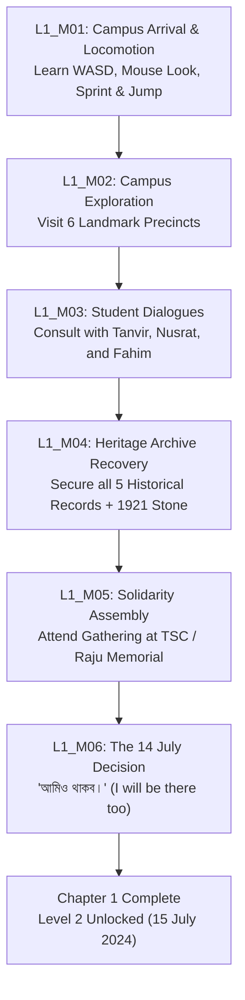

# SparkVision — Level 1 Gameplay Design
**Chapter Title:** Chapter 1: "Where It All Began"  
**Historical Period:** July 1 – 14, 2024  
**Setting:** University of Dhaka Campus, Bangladesh (Curzon Hall Heritage Precinct, Doyel Chattar, Shaheed Minar, TSC, Central Library, Arts Faculty)  
**Authoritative Sources:** `LEVELS.md` & `2x12_COMPLETE_GAME_PLAN.md`  

---

## 1. Narrative & Atmospheric Direction

Level 1 chronicles the genesis of the July 2024 student-led movement in Bangladesh.
- **Atmosphere:** Warm summer monsoon daylight, verdant rain trees, colonial brick arches of Curzon Hall, peaceful campus pathways, academic discussions, posters, and quiet resolve.
- **Combat Canon:** **Combat is strictly disabled.** No weapons, combat stances, hostile encounters, or health loss. The player participates as a student observer-scholar navigating the campus.

---

## 2. The Mission Sequence (`L1_M01` – `L1_M06`)

### Detailed Mission Specs

| Mission ID | Name | Objectives | Triggers / Conditions |
| :--- | :--- | :--- | :--- |
| **`L1_M01`** | **Campus Arrival** | Practice movement, camera orbit, sprint, and jump around Curzon Hall south lawn. | Move at least 500 cm, sprint, and jump. Automatically updates to `L1_M02`. |
| **`L1_M02`** | **Landmark Survey** | Traversal through Curzon Hall, Doyel Chattar, Shaheed Minar, TSC, Central Library, and Arts Faculty. | Visit at least 3 distinct landmark zones or utilize the fast travel exploration network. |
| **`L1_M03`** | **Voices of the Campus** | Speak with 3 key student leaders: Tanvir (Curzon), Nusrat (Central Library), Fahim (TSC). | Interact with each NPC via `[E]`, hearing both Bengali dialogue and English subtitles. |
| **`L1_M04`** | **Securing the Archives** | Recover the 5 historical archive terminals and inspect the 1921 Boundary Stone:  1. Curzon Hall Arcade Founding Record (1904) 2. Aparajeyo Bangla 1952/1971 Chronicle 3. Raju Anti-Terrorism Memorial Declaration 4. Central Library Reform Gazette 5. TSC Unity Manifesto + 1921 Boundary Stone at Shaheed Minar. | All 5 archives registered in `SVMissionControlSubsystem` and local save. |
| **`L1_M05`** | **Solidarity Assembly** | Gather with fellow students at the TSC / Raju Sculpture plaza for the evening discussion. | Reach Raju Memorial at TSC with all 5 archives secured. |
| **`L1_M06`** | **The July 14 Resolution** | Confirm participation in the upcoming nationwide demonstration: *"আমিও থাকব।"* ("I will be there too."). | Final interaction prompt at Raju Memorial; triggers cinematic transition and Level 2 unlock. |

---

## 3. Objective State Machine

Every objective transitions through standardized states:
1. `LOCKED`: Prerequisite mission not yet finished.
2. `ACTIVE`: Current quest displayed on HUD compass and objective panel.
3. `IN_PROGRESS`: Sub-tasks partially fulfilled (e.g. 3/5 archives recovered).
4. `COMPLETED`: Conditions met; broadcasted to Java Mission Control, saved to disk, next mission unrolls.

---

## 4. Chapter 1 Completion & Chapter 2 Handoff
Upon completion of `L1_M06`:
- The HUD initiates cinematic letterboxing.
- Bengali historic title card renders: **“আমিও থাকব।”** with subtitle *"July 14, 2024 — The commitment was made."*
- Java Mission Control persists `LEVEL1_COMPLETED` and unlocks `chapter-02` ("The Day the Streets Changed", July 15, 2024).
- The player is returned to the Main Menu with **Continue Game** pointing to the unlocked Chapter 2 state, or may continue free-roam exploration across the campus.
