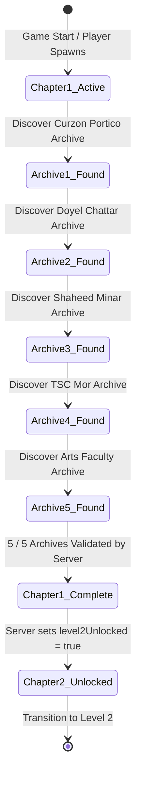

# SPARKVISION — MISSION PROGRESSION & STATE SYNCHRONIZATION

## 1. Title & Executive Purpose

* **Document**: `MissionProgression.md`
* **Purpose**: Defines quest progression structures, archive collection thresholds, chapter gating logic, and synchronization between Unreal Engine gameplay events and the persistent Java Mission Control database.

---

## 2. Chapter 1 Milestone Architecture



---

## 3. Server Milestone Verification Contract

Whenever the player retrieves an archive terminal, `USVMissionControlSubsystem` executes `POST /api/v1/chapter-01/archive`:

```json
{
  "sessionId": "unreal_session_1793434577",
  "archiveId": "archive_03",
  "location": "Shaheed Minar",
  "timestamp": 1793434580000
}
```

The Java server responds with updated chapter telemetry:

```json
{
  "success": true,
  "chapterId": "chapter-01",
  "archivesFound": 3,
  "totalArchivesRequired": 5,
  "level2Unlocked": false,
  "message": "Archive registered: archive_03"
}
```

When `archivesFound == 5`:
* `level2Unlocked` flips to `true`.
* `USVMissionControlSubsystem` broadcasts `OnLevel2UnlockedDelegate`.
* The game triggers a victory cinematic and opens the transit portal at the Arts Faculty gate.

---

## 4. Current Status

* **Status**: `COMPLETED`
* **Evidence**:
  - Session registration and mission milestone telemetry verified in live PIE logs:
    `[SVMissionControlSubsystem] Missions updated: 5 / 5 archives, Level 2 Unlocked: 1`.
  - SQLite persistence verified across application restarts.
* **Remaining Tasks**:
  - Connect dynamic on-screen quest notification banner to `OnMissionUpdatedDelegate`.
