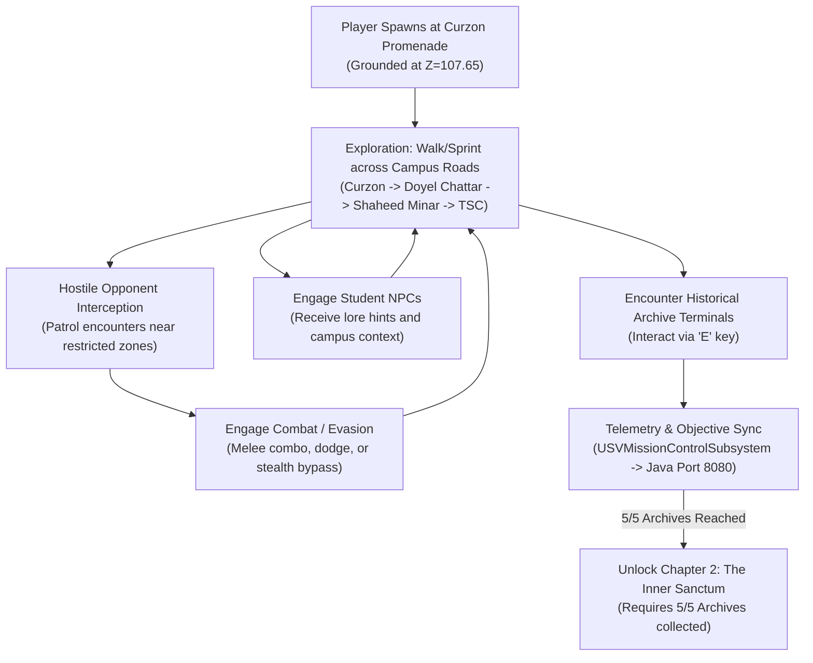

# SPARKVISION — GAMEPLAY SYSTEMS, MECHANICS & NARRATIVE SUITE

## 1. Purpose & Scope

This directory documents the gameplay design, interactive mechanics, character controls, combat systems, and narrative progression that bring the semi-open-world University of Dhaka to life in **SparkVision**.

Gameplay blends cinematic third-person exploration, historic investigation, cultural dialogue, and martial defense inspired by the fluid movement and environmental responsiveness of *Where Winds Meet* and *Ghost of Tsushima*.

---

## 2. Directory Index

* [`Level1_GameplayDesign.md`](file:///Users/atiaoishi/Downloads/sparkvision/Documentation/Gameplay/Level1_GameplayDesign.md): Narrative arc, mission objectives, exploration routes, and level milestones for Chapter 1 (Curzon Hall & Historic Campus).
* [`CharacterAndNPCs.md`](file:///Users/atiaoishi/Downloads/sparkvision/Documentation/Gameplay/CharacterAndNPCs.md): Player character pawn specification, movement physics, friendly student NPCs, and hostile opponent behavior.
* [`InteractionSystem.md`](file:///Downloads/sparkvision/Documentation/Gameplay/InteractionSystem.md): Archive terminals (`SVArchiveTerminal`), proximity triggers, dialogue widgets, and contextual input prompts.
* [`CombatSystem.md`](file:///Users/atiaoishi/Downloads/sparkvision/Documentation/Gameplay/CombatSystem.md): Combat framework, hit reactions, melee combos, parry timings, and historical defensive mechanics.
* [`MissionProgression.md`](file:///Users/atiaoishi/Downloads/sparkvision/Documentation/Gameplay/MissionProgression.md): Objective chains, archive collection milestones, level unlock conditions, and state synchronization with Java Mission Control.

---

## 3. High-Level Core Gameplay Loop

---

## 4. Current Status

* **Status**: `IN PROGRESS`
* **Evidence**:
  - Live PIE character possession and third-person controls verified (`PIE_Live_Gameplay_Verified.png`).
  - 5 Historical Archive terminals and student NPCs placed in level and linked to backend.
* **Remaining Tasks**:
  - Implement full combat animation montages and combo branching on `BP_ThirdPersonCharacter`.
