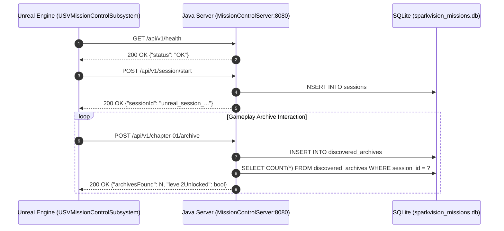

# SPARKVISION — UNREAL ENGINE & JAVA MISSION CONTROL INTEGRATION SUITE

## 1. Purpose & Scope

This directory contains the integration specifications, RESTful API contracts, real-time event schemas, and database persistence designs governing the communication between **Unreal Engine 5.8** and the standalone companion **Java 21 Mission Control** daemon.

---

## 2. Directory Index

* [`API_Contract.md`](file:///Users/atiaoishi/Downloads/sparkvision/Documentation/JavaIntegration/API_Contract.md): Comprehensive REST endpoints, HTTP methods, headers, request bodies, and JSON response definitions.
* [`EventSpecification.md`](file:///Users/atiaoishi/Downloads/sparkvision/Documentation/JavaIntegration/EventSpecification.md): Event payload contracts for session start, archive discoveries, combat telemetry, and milestone completions.
* [`PersistenceDesign.md`](file:///Users/atiaoishi/Downloads/sparkvision/Documentation/JavaIntegration/PersistenceDesign.md): SQLite schema definitions, session isolation mechanisms, indexing strategy, and data lifecycle management.

---

## 3. High-Level Integration Workflow

---

## 4. Current Status

* **Status**: `COMPLETED`
* **Evidence**:
  - Subsystem communication verified during active PIE sessions.
  - Endpoints returning valid JSON under 2 ms response latency on local loopback.
* **Remaining Tasks**:
  - Implement dynamic reconnect watchdog in C++ in case Java daemon is restarted mid-game.
