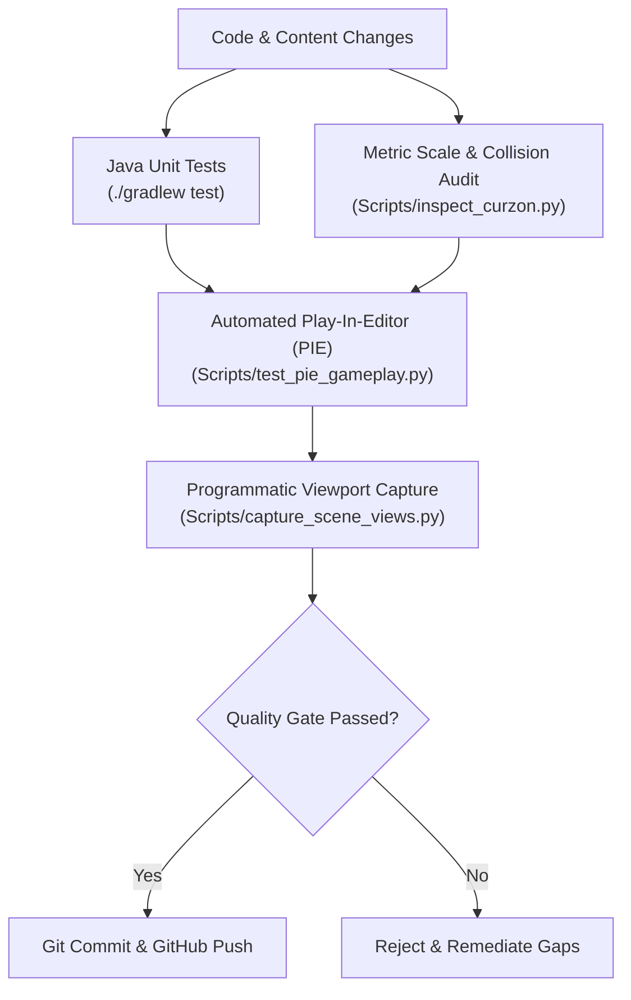

# SPARKVISION — QUALITY ASSURANCE & VERIFICATION SUITE

## 1. Purpose & Scope

This directory contains the testing methodologies, automated verification scripts, gameplay test matrices, visual regression procedures, and performance benchmarks for **SparkVision: University of Dhaka**.

Quality gates are enforced continuously across both the **Unreal Engine 5.8** client and the **Java 21 Mission Control** subsystem.

---

## 2. Directory Index

* [`TestStrategy.md`](file:///Users/atiaoishi/Downloads/sparkvision/Documentation/Testing/TestStrategy.md): Multi-tiered automated and manual testing framework spanning unit, integration, visual regression, and PIE gameplay runs.
* [`GameplayTestCases.md`](file:///Users/atiaoishi/Downloads/sparkvision/Documentation/Testing/GameplayTestCases.md): Test cases covering player pawn possession, WASD movement, jump physics, collision volumes, and terminal interaction.
* [`VisualRegressionTests.md`](file:///Users/atiaoishi/Downloads/sparkvision/Documentation/Testing/VisualRegressionTests.md): Fixed-camera viewport capture benchmarks and image comparison procedures.
* [`PerformanceBenchmark.md`](file:///Users/atiaoishi/Downloads/sparkvision/Documentation/Testing/PerformanceBenchmark.md): Target frame rates, draw call budgets, Nanite triangle budgets, and unified memory metrics on Apple Silicon (M4 / 16 GB).

---

## 3. High-Level Testing Pipeline

---

## 4. Current Status

* **Status**: `COMPLETED`
* **Evidence**:
  - Live PIE testing automated via Unreal MCP `StartPIE` / `StopPIE`.
  - Java Gradle tests passing with zero failures.
* **Remaining Tasks**:
  - Integrate pixel-diff visual comparison automation via OpenCV/Pillow in Python.
