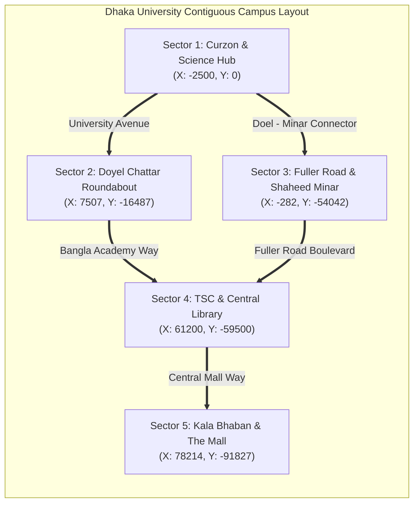

# UNIVERSITY OF DHAKA — CAMPUS VEGETATION MASTERPLAN
## Contiguous 1.6 km × 1.4 km Open-World Environmental Layout & Spatial Blueprint

---

### 1. Master Geographic Framework

* **Coordinate System**: WGS 84 / UTM Zone 46N (EPSG: 32646)
* **World Origin / Anchor**: Curzon Hall South Entrance `(X: -2500, Y: 0, Z: 0)`
* **Total Simulated Footprint**: $1,600\text{ m} \times 1,400\text{ m}$ ($2.24\text{ km}^2$)
* **Core Design Standard**: Low-to-Moderate Density, Open Lawns, Visible Monumental Silhouettes, 100% Unobstructed Traversal.

---

### 2. Sector-by-Sector Vegetation Master Blueprint

#### Sector 1: Curzon Hall & Science Precinct
* **Boundary Coordinates**: $X \in [-6000, 7000], Y \in [-7000, 7000]$
* **Landscape Identity**: High-Prestige British-Mughal Formal Heritage Precinct.
* **Vegetation Strategy**:
  * **Front Facade & Plinth**: Strict Open Landmark Policy. Symmetrically flanked by exactly **2 Royal Palms** (`X = -3350, Y = ±850`) and low geometric boxwood hedges (`SM_Curzon_Hedge_Low`) along the plinth walkway. Front lawn is $100\%$ open green grass.
  * **Curzon Botanical Pond** `(X: 4800, Y: 0)`: Stepped red-brick ghat on south edge, 6 purple Jarul trees along eastern bank, 4 Kadam trees along northern boundary, floating clusters of Shapla water lilies, and Kashful reeds at marshy edges.
  * **Perimeter Boulevards**: Set back 14m from facades. 12 mature Rain Trees along the outer eastern and western perimeter roads providing deep natural shade.
  * **Shahidullah Hall Quad** `(X: 5000, Y: -5000)`: Internal quadrangle garden with 4 fruit trees (Mango, Guava) and central open turf.

---

#### Sector 2: University Avenue & Doyel Chattar
* **Boundary Coordinates**: $X \in [5000, 20000], Y \in [-25000, -10000]$
* **Landscape Identity**: Tree-Lined Colonial Academic Thoroughfare & National Symbol.
* **Vegetation Strategy**:
  * **Doyel Chattar Roundabout** `(X: 7507, Y: -16487)`: Open circular lawn with low trimmed flowering shrubs, allowing unobstructed view of the bronze Magpie-Robin sculpture.
  * **University Avenue**: Stately avenue lined on both sides with arching Rain Trees (*Albizia saman*) and alternating Krishnachura, spaced 22 meters apart, creating a shaded canopy tunnel while maintaining clear road sightlines.
  * **Bangla Academy (Burdwan House)**: Perimeter Debdaru (*Polyalthia longifolia*) screen and heritage lawn.

---

#### Sector 3: Memorial & Residential Corridor
* **Boundary Coordinates**: $X \in [-5000, 30000], Y \in [-75000, -45000]$
* **Landscape Identity**: National Language Movement Memorial & Shaded Residential Hall Enclaves.
* **Vegetation Strategy**:
  * **Central Shaheed Minar** `(X: -282, Y: -54042)`: Reverent Monumental Clearance. The central red sun disc and inclined marble pillars are kept 100% visible from all approaches. Perimeter lined with sacred Peepal (*Ficus religiosa*) and Banyan trees at least 18m back from the marble altar.
  * **Fuller Road Boulevard**: The iconic DU "Tree Tunnel" formed by mature Mahoganies and Rain Trees planted along both verges with 5m clearance from the road edge.
  * **Salimullah Muslim (SM) Hall** `(X: 15000, Y: -68000)`: Fortified gatehouse framed by 4 tall Coconut Palms; central quad court featuring open manicured grass and small flowerbeds.
  * **Jagannath Hall Quad**: Historic red-brick quadrangle with open central sports lawn and perimeter flowering trees.

---

#### Sector 4: TSC Mor & Central Library Precinct
* **Boundary Coordinates**: $X \in [50000, 85000], Y \in [-75000, -55000]$
* **Landscape Identity**: Dynamic Student Civic Core & Tropical Modernist Masterpieces.
* **Vegetation Strategy**:
  * **Anti-Terrorism Raju Memorial Sculpture** `(X: 58964, Y: -63725)`: Open paved intersection with circular traffic clearance.
  * **Teacher-Student Centre (TSC)** `(X: 61200, Y: -59500)`: Doxiadis folded-plate concrete roof framed by light tropical palms (Royal Palm, Areca) and flowering Plumeria (*Kathgolap*). Open internal lawn for student assemblies.
  * **DU Central Library & Hakim Chattar** `(X: 73459, Y: -71699)`: Muzharul Islam's pilotis breezeway fronted by open lawn; shaded reading grove under fragrant Neem trees (*Azadirachta indica*).
  * **DU Central Mosque & Kazi Nazrul Islam Mausoleum** `(X: 82582, Y: -72180)`: Serene white dome framed by slender Betel Nut palms; marble tomb shaded by frangipani.

---

#### Sector 5: Arts, Social Sciences & The Mall
* **Boundary Coordinates**: $X \in [70000, 95000], Y \in [-100000, -80000]$
* **Landscape Identity**: Sprawling Modernist Campus Green & Iconic Liberation Memorials.
* **Vegetation Strategy**:
  * **Arts Faculty (Kala Bhaban)** `(X: 78214, Y: -91827)`: 160-meter horizontal block visible across a wide, open grassy plaza.
  * **Aparajeyo Bangla** `(X: 73486, Y: -95794)`: 11-meter concrete sculpture framed from behind by 4 blooming Krishnachura trees, creating a dramatic natural red backdrop.
  * **The Mall**: Expansive open grassland centered on two massive, iconic, ancient specimen Banyan trees (*Ficus benghalensis*) with aerial prop roots, preserved with 25m open space around each canopy.

---

### 3. Open Space vs. Canopy Coverage Target Ratios

| Campus Sector | Total Area ($\text{m}^2$) | Open Lawns & Plazas (%) | Canopy Coverage (%) | Road / Walkway Area (%) | Primary Aesthetic Standard |
| :--- | :---: | :---: | :---: | :---: | :--- |
| **Sector 1: Curzon & Science** | 168,000 | **54%** | **22%** | 24% | Formal, Symmetrical, Palatial |
| **Sector 2: Doyel Avenue** | 140,000 | **35%** | **38%** | 27% | Linear Shaded Avenue |
| **Sector 3: Fuller & Minar** | 210,000 | **50%** | **26%** | 24% | Solemn, Memorial, Residential |
| **Sector 4: TSC & Library** | 175,000 | **48%** | **25%** | 27% | Modernist, Active, Gathering |
| **Sector 5: Arts & The Mall** | 196,000 | **60%** | **18%** | 22% | Vast Open Lawn, Specimen Trees |
| **Total Campus Average** | **889,000** | **49.4%** | **25.8%** | **24.8%** | **Open, Natural & Spacious** |
