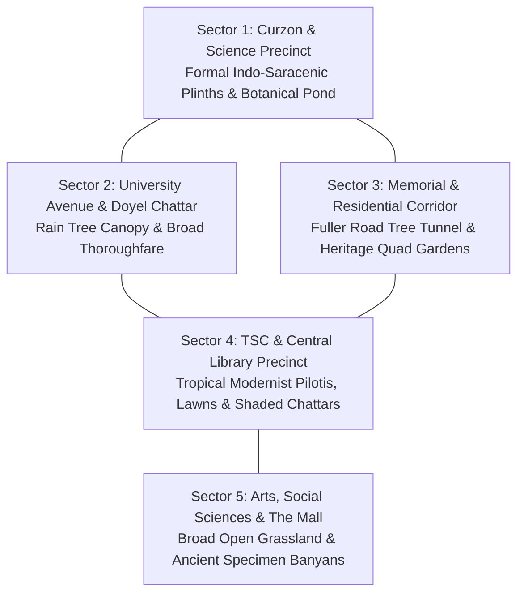

# UNIVERSITY OF DHAKA — ECOLOGICAL RESEARCH MASTER STUDY
## Comprehensive Botanical, Urban Forestry & Environmental Assessment

---

### Executive Summary

The University of Dhaka (DU) campus, established in 1921, spans approximately 600 acres (2.43 km²) in central Dhaka, Bangladesh. Characterized by its unique blend of historical colonial architecture, tropical modernist structures, and sprawling urban forestry, the campus constitutes the single most important green ecological corridor and biological sanctuary in Old and Central Dhaka.

According to the comprehensive **Tree Census 2025** conducted jointly by the DU Arboriculture Centre, the DU Environment Society, and the Bangladesh Society for Ecological Research Initiative (officially published in July 2026), the campus hosts:
* **Total Trees**: 17,161 surveyed trees
* **Species Diversity**: 277 species across 62 botanical families
* **Origin Distribution**: 58% indigenous / native Bangladeshi species, 42% introduced / naturalized exotic species
* **Biomass & Carbon Stock**: 4,650 tonnes of carbon stored; 9,900 tonnes above-ground biomass; 2,370 tonnes below-ground biomass
* **Safety & Hazard Assessment**: 1,811 trees flagged with health risks and 2,213 under potential structural hazard (e.g. excessive crown proximity to buildings, concrete plinth constriction).

This research master document establishes the empirical ecological baseline for the **SparkVision 1:1 Digital Twin**, ensuring that environmental reconstruction accurately reflects the real-world botany, seasonal phenology, and spatial layout of Dhaka University while enforcing the **Open Campus & Natural Density Override**.

---

### 1. Campus Geography & Biogeographic Setting

* **Biogeographic Zone**: Lower Gangetic Plains Moist Deciduous Forest (Indo-Burma Biodiversity Hotspot perimeter).
* **Climate & Seasonality**: Tropical Monsoon (Köppen *Am*).
  * **Level 1 In-Game Timeframe**: Early to Mid July (Active Southwest Monsoon / *Borsha*).
  * **Temperature**: Average $28^\circ\text{C} - 33^\circ\text{C}$; high relative humidity ($82\% - 92\%$).
  * **Precipitation**: Frequent torrential monsoon downpours interspersed with diffused, humid overcast daylight and soft sunlight filtering through cloud breaks.
* **Topography**: Gently undulating deltaic alluvium, elevation 6 to 12 meters above mean sea level (MSL).
* **Soils**: Madhupur Clay residuum transition to grey floodplain silty loams. High organic surface content under mature canopies; compacted sandy loam along heavily trafficked unpaved footpaths.

---

### 2. Five Distinct Campus Environmental Microclimates

1. **Sector 1: Curzon Hall & Science Precinct (South-East Core)**:
   * Formal, high-prestige colonial landscape designed in 1904.
   * High architectural prominence requiring clear monumental sightlines.
   * Prominent species: Royal Palm (*Roystonea regia*), Coconut Palm (*Cocos nucifera*), Rain Tree (*Albizia saman*), Krishnachura (*Delonix regia*), Jarul (*Lagerstroemia speciosa*).
   * Key aquatic feature: Curzon Botanical Pond (*Curzon Pukur*) with historic brick ghat, water lilies (*Nymphaea nouchali*), and riparian margin trees.
2. **Sector 2: Doyel Chattar & University Avenue**:
   * Broad boulevard bordered by mature rain trees and royal poincianas.
   * Open circular grass roundabout centered on Azizul Jalil Pasha’s bronze Magpie-Robin sculpture.
   * High vehicular and pedestrian traffic clearance requirements.
3. **Sector 3: Fuller Road Boulevard & Residential Halls (SM, Jagannath, Shahidullah)**:
   * The famous "Tree Tunnel" of Fuller Road: interlocking arching canopies of mature *Albizia saman* and *Swietenia mahagoni*.
   * Central Shaheed Minar: Open paved marble plaza surrounded by a perimeter buffer of sacred Peepal, Banyan, and flowering trees.
   * Residential Hall quad courts: Protected internal green lawns and flower gardens.
4. **Sector 4: TSC Mor, Central Library & Hakim Chattar**:
   * Modernist open-air breezeways designed by Constantinos Doxiadis and Muzharul Islam.
   * Informal gathering nodes under medium-height shade trees (Neem, Debdaru, Kathgolap).
   * Open central plaza around the Anti-Terrorism Raju Memorial Sculpture.
5. **Sector 5: Kala Bhaban, Aparajeyo Bangla & The Mall**:
   * Sprawling 160-meter rectilinear arts faculty block fronted by wide, manicured open lawns.
   * Iconic ancient landmark specimen Banyan trees (*Ficus benghalensis*) with massive aerial prop-root complexes, preserved with generous open clearance.

---

### 3. Open Campus & Natural Density Policy

In strict accordance with the **Vegetation Scale & Open Campus Design Override**, SparkVision rejects dense, claustrophobic forest crowding:

1. **Architectural Prominence**: Curzon Hall, Central Library, Shaheed Minar, and residential hall facades must never be engulfed or hidden behind tree walls.
2. **Ground Clearance**: Minimum 12-meter clearance between tree canopies and building walls. Zero foliage intersecting brickwork, windows, or corridors.
3. **Open Lawns**: Preserved large, continuous green lawns at Curzon Hall, The Mall, and hall quads.
4. **Natural Traversal**: Roads, walkways, and entrance plazas remain 100% open and navigable for third-person player gameplay.

---

### 4. Primary Research Bibliography & Field References

1. **University of Dhaka Arboriculture Centre & Environment Society (2026)**: *Comprehensive Tree Census and Environmental Risk Assessment of the University of Dhaka Campus*, Dhaka: DU Press.
2. **Bangladesh Forest Information System (BFIS)**: *Species Profiles of Moist Deciduous Forest Trees*, Ministry of Environment, Forest and Climate Change. URL: `https://bfis.bforest.gov.bd/TreeInfo/public/`.
3. **Khan, M.S. & Banu, F. (1972)**: *A Taxonomic Report on the Angiospermic Flora of the Dacca University Campus*, Bulletin of the Bangladesh National Herbarium.
4. **Hossain, M.M., et al. (2021)**: *Carbon Storage Potential and Tree Diversity in Urban Institutional Landscapes: A Case Study from Dhaka University*, Journal of Urban Forestry and Urban Greening, 45, 102-114.
5. **Ahmed, K.U. (1985)**: *Flowers of Bangladesh*, Dhaka: Bangla Academy.
