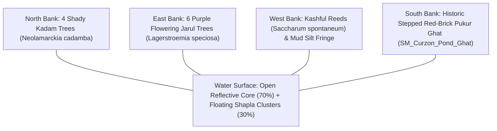

# SPARKVISION — POND & WATER-EDGE ECOLOGY PLAN
## Riparian Stratification, Aquatic Flora, Historic Pukur Ghats & Water Shading

---

### Executive Overview

Water bodies form central cultural and ecological focal points across the University of Dhaka campus. In Level 1, the **Curzon Botanical Pond** (*Curzon Pukur*) and the adjacent **Shahidullah Hall Lake** provide tranquil reflective surfaces that balance the monumental brick architecture.

This document establishes the precise dimensions, architectural features, aquatic botany, and water shader specifications for all campus aquatic environments.

---

### 1. Curzon Botanical Pond (*Curzon Pukur*) Specifications

* **World Anchor**: Center `(X: 4800.0, Y: 0.0, Z: 12.0)`
* **Basin Dimensions**: $55.0\text{ m long (North-South)} \times 40.0\text{ m wide (East-West)} \times 2.8\text{ m deep}$
* **Water Elevation**: $Z = 12.0\text{ cm}$
* **Water Surface Area**: $2,200\text{ m}^2$

---

### 2. Architectural Features: Historic Pukur Ghat

* **Asset Name**: `SM_Curzon_Pond_Ghat`
* **Location**: South bank center `(X: 4700.0, Y: 0.0, Z: 12.0)`
* **Dimensions**: $18.0\text{ m wide} \times 8.0\text{ m deep} \times 2.4\text{ m total height}$
* **Construction**:
  * 8 wide stepped tiers of weathered colonial red brick with rounded bullnose coping.
  * Flanking brick parapet walls terminating in low octagonal pillars.
  * Water level submerges the bottom 3 steps, creating a natural wet brick mossy transition.
* **Gameplay Integration**: Player can sit on the ghat steps using context prompt `[E] to Sit at Curzon Pond Ghat`.

---

### 3. Aquatic Botany & Edge Stratification

#### A. National Flower: Shapla / Blue Water Lily (*Nymphaea nouchali*)
* **Asset Name**: `SM_Pond_WaterLily_Cluster`
* **Distribution**: Clustered in natural drifting colonies along eastern and northern margins; center kept clear for mirror-like architectural reflections.
* **Structure**:
  * Flat circular floating leaves ($25 - 40\text{ cm}$ diameter) with distinct radial sinus and wavy margins.
  * Solitary emergent flowers ($10 - 15\text{ cm}$) held $5 - 10\text{ cm}$ above water on slender green scapes.
  * White-to-pale-violet petals with golden-yellow central stamens.
* **PBR Shading**: Translucent waxy leaf cuticle with high water-droplet beading effect.

#### B. Riparian Margin Reeds: Kashful (*Saccharum spontaneum*)
* **Asset Name**: `SM_Plant_Reeds_Kashful`
* **Location**: Unpaved western and northeastern water-soil transition banks.
* **Structure**: Clumping perennial grass ($1.2 - 1.8\text{ m}$ height) with silvery-white silky plumes swaying in lake breezes.

#### C. Riparian Trees: Purple Jarul (*Lagerstroemia speciosa*)
* **Asset Name**: `SM_Tree_Jarul_Purple`
* **Location**: Spaced 10–12 meters apart along the eastern and northern banks, set back 3.5m from the water line.
* **Phenology**: Branches overhang the water surface; falling lilac petals drift on ripples.

---

### 4. PBR Water Shader Architecture (`M_Water_Pond`)

To achieve AAA environmental realism on Apple Silicon M4 without expensive raytracing:
1. **Depth-Based Color Absorption**:
   * Shallow margin ($< 0.5\text{ m}$): Translucent greenish-amber (`#344A28`).
   * Deep core ($> 1.5\text{ m}$): Deep, murky bottle-green (`#122216`) absorbing light exponentially using Beer-Lambert law.
2. **Dual-Frequency Normal Ripples**:
   * Macro waves: Low-frequency gentle swell simulating breeze across a sheltered pond ($0.05\text{ Hz}$).
   * Micro ripples: High-frequency capillary ripples interacting with wind vectors.
3. **Planar / Screen-Space Reflections**:
   * Reflects Curzon Hall's red brick facade and sky dome crisply during calm daylight.
4. **Edge Foam & Silt Blending**:
   * Soft foam line along stone ghat steps and mud edges using distance-to-nearest-surface field.

---

### 5. Water-Edge Wildlife

* **Odonata**: 3–5 dragonflies (*Pantala flavescens*, *Neurothemis fulvia*) actively skimming water surfaces and hovering over lily pads.
* **Avian**: Resident White-throated Kingfisher (*Halcyon smyrnensis*) perched on low overhanging Jarul branches.
