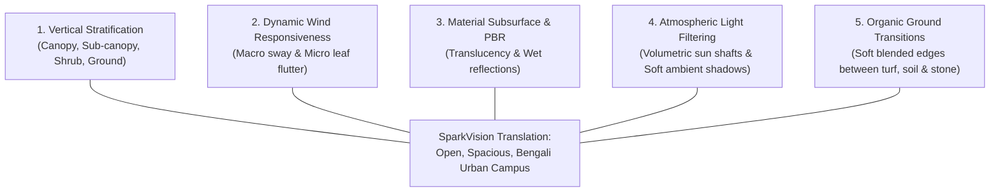

# WHERE WINDS MEET — ENVIRONMENTAL DESIGN ANALYSIS
## Translating AAA Environmental Richness to the Open University of Dhaka Campus

---

### Executive Overview

*Where Winds Meet* (Everstone Studio / NetEase Games) has established a new benchmark for open-world environmental fidelity, organic vegetation density, foliage animation, and atmospheric lighting. However, directly copying its fantasy wuxia forest density to the University of Dhaka would destroy the campus’s historic architectural identity and violate the **Open Campus & Natural Density Override**.

This study analyzes the specific technical and artistic principles of *Where Winds Meet* and translates them into an authentic, spacious, and believable University of Dhaka environment.

---

### 1. Core Environmental Principles of Where Winds Meet

---

### 2. Deep Comparative Breakdown: WWM vs. SparkVision DU Campus

| Environmental Dimension | Where Winds Meet (WWM Reference) | Incorrect Naive Approach | SparkVision Authentic DU Campus Translation |
| :--- | :--- | :--- | :--- |
| **Vegetation Density** | Dense, multi-layered untamed wilderness and dense bamboo forests | Scattering hundreds of random trees until the screen is full | **Low-to-Moderate, Spacious Density**: Open lawns, tree-lined boulevards, clear architectural sightlines. |
| **Tree-to-Building Scale** | Towering fantasy trees that dwarf pavilions | Giant trees hiding Curzon Hall towers and blocking verandas | **Botanically Calibrated Proportions**: Trees scaled 5m to 20m, strictly proportionate to 25.2m Curzon Hall. |
| **Architectural Visibility** | Architecture often discovered nestled deep inside forests | Buildings obscured by tree canopies penetrating walls | **Prominent Monumental Architecture**: 12m clear setback from heritage facades. Zero wall clipping. |
| **Ground & Turf Quality** | Dense tall wild grassland and thick undergrowth | Uniform flat green texture across entire map | **Layered Surface Transitions**: Maintained short turf, moist garden loam, tree-root soil, and petal decals. |
| **Foliage Shading & PBR** | High subsurface scattering, soft ambient occlusion, leaf translucency | Flat unlit diffuse green materials | **Authentic PBR Shading**: Two-sided foliage shading with green-gold transmission, natural chlorophyll hues. |
| **Wind & Dynamics** | Continuous cinematic wind creating waves across grass and bamboo | Static rigid meshes or violent unnatural shaking | **Gentle Monsoon Breeze**: Directional wind vectors ($2.5 - 4.5\text{ m/s}$), phase-offset leaf flutter. |
| **Aquatic Environment** | Mystical misty rivers with lotus and reflection | Flat opaque blue planes | **Living Tropical Pond**: Water lilies (*Shapla*), brick ghat steps, soft ripple normals, and dragonflies. |

---

### 3. Key Technical Translations into Unreal Engine 5.8

#### A. Vertical Stratification (Open Adaptation)
Rather than packing every square meter with all four layers (which creates an impassable jungle), we deploy stratification **contextually**:
1. **Heritage Plinths (Curzon Hall)**:
   * Canopy: Zero trees directly in front. Flanked by 2 slender Royal Palms ($16\text{ m}$).
   * Shrub: Low manicured boxwood hedge ($0.85\text{ m}$) framing the plinth walkway.
   * Ground: Open manicured short lawn ($4 - 6\text{ cm}$) and clean brick promenade.
2. **Roadside Boulevards (Fuller Road / University Avenue)**:
   * Canopy: Mature Rain Trees and Mahoganies ($18\text{ m}$) spaced 20–25 meters apart.
   * Sub-Canopy: Occasional flowering Krishnachura / Radhachura ($11\text{ m}$) at major nodes.
   * Ground: Turf verges, tree-pit loam, and root flares set 4m back from road kerbs.
3. **Botanical Pond Margins**:
   * Canopy/Sub-Canopy: Moisture-loving Jarul ($10\text{ m}$) and Kadam ($12\text{ m}$).
   * Shrub/Reeds: Clumps of Kashful reeds ($1.5\text{ m}$) at unpaved muddy edges.
   * Aquatic: Floating Shapla water lilies and pads clustered near shorelines.

#### B. PBR Foliage Shading & Subsurface Scattering
* Leaves use Unreal's `Two-Sided Foliage` shading model.
* Subsurface color is tuned to vibrant sunlit chlorophyll (`r: 0.18, g: 0.38, b: 0.08`), giving backlit leaves a natural warm glow when sunlight passes through the canopy.
* Roughness varies between 0.35 (glossy upper cuticle) and 0.65 (matte lower epidermis).

#### C. Organic Ground Transitions (No Abrupt Seams)
* Replacing the single flat green terrain with multi-layered material blending:
  * Short manicured turf along paths.
  * Moist, compacted dark loam under tree canopies.
  * Soft edge blending between asphalt roads, concrete walkways, and grass using vertex paint or distance-to-nearest-surface masks.
  * Scattered red petal decals beneath blooming Krishnachura trees.

---

### 4. Summary

By adapting Where Winds Meet's **rendering quality and material craftsmanship** while rejecting its **jungle crowding**, SparkVision achieves a world that looks visually stunning, graphically rich, and undeniably authentic to the real University of Dhaka.
