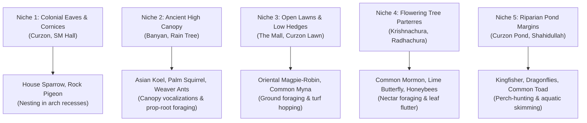

# SPARKVISION — WILDLIFE HABITAT & AMBIENT FAUNA DESIGN
## Ecological Niche Mapping, Behavioral Triggers & Lightweight Ambient Systems

---

### Executive Overview

Urban wildlife on the University of Dhaka campus is diverse, resilient, and deeply integrated with the historical architecture and ancient trees. Rather than constructing heavy, compute-intensive AI agents for small creatures, SparkVision utilizes **lightweight, spatially bounded ambient systems** to give the campus believable, organic life while preserving 60 FPS performance on Apple Silicon M4.

---

### 1. Campus Ecological Niche Architecture

---

### 2. Behavioral Protocols by Habitat

#### Niche 1: Colonial Eaves & Veranda Cornices
* **Primary Inhabitants**: House Sparrow (*Passer domesticus*), Common Pigeon (*Columba livia*).
* **Behavior**:
  * Perched along stone cornices, capitals, and window lintels of Curzon Hall and SM Hall.
  * Idle animations: Head-bobbing, preening, fluttering between adjacent column capitals.
  * Player Reaction: If player approaches within 3.5 meters along the veranda, sparrows take flight in a brief arc and land on the upper parapet.

#### Niche 2: Ancient Canopy & Prop Roots
* **Primary Inhabitants**: Asian Koel (*Eudynamys scolopaceus*), Northern Palm Squirrel (*Funambulus pennantii*).
* **Behavior**:
  * Asian Koel is heard predominantly via spatialized audio emitters placed high in mature Banyan and Rain Tree crowns.
  * Palm Squirrels spawn near trunk bases and scamper up bark fissures and aerial prop roots when player walks past.

#### Niche 3: Open Turf Lawns & Hedges
* **Primary Inhabitants**: Oriental Magpie-Robin (*Copsychus saularis* / Doyel), Common Myna (*Acridotheres tristis*).
* **Behavior**:
  * Pairs of Doyel birds hop along maintained grass edges and low manicured hedges.
  * Flocks of 3–5 Mynas peck at lawn soil.
  * Flush Behavior: When player sprints nearby, birds disperse with a short chatter and land 15m away on lawn turf.

#### Niche 4: Flowering Tree Blooms
* **Primary Inhabitants**: Common Mormon (*Papilio polytes*), Plain Tiger (*Danaus chrysippus*), Honeybees (*Apis cerana*).
* **Behavior**:
  * Butterfly particle loops drift lazily in 3D paths around scarlet Krishnachura and yellow Radhachura flower heads.
  * Flight speed: Gentle, fluttery $0.8 - 1.4\text{ m/s}$.

#### Niche 5: Riparian Pond Margins
* **Primary Inhabitants**: Globe Skimmer Dragonfly (*Pantala flavescens*), White-throated Kingfisher (*Halcyon smyrnensis*).
* **Behavior**:
  * Dragonflies hover stably over Shapla water lily pads and dart quickly to hunt midges.
  * Kingfisher perches silently on overhanging Jarul branches, with occasional rapid diving animation into water ripples.

---

### 3. Technical Implementation & Performance Budget

1. **GPU Particle Systems (Niagara)**:
   * Butterflies and dragonflies are driven by GPU sprite particles with lightweight curl noise.
   * Total active particles campus-wide: $< 80$ simultaneous instances ($< 0.04\text{ ms}$ GPU cost).
2. **Spline-Triggered Avian Flocks**:
   * Pre-authored flight splines for dispersing birds; zero active physics or collision checks required.
3. **Audio Spatialization**:
   * Attenuation radius: Inner $8.0\text{ m}$, Outer $35.0\text{ m}$.
   * High-frequency bird calls smoothly occluded behind building walls using audio trace geometry.
