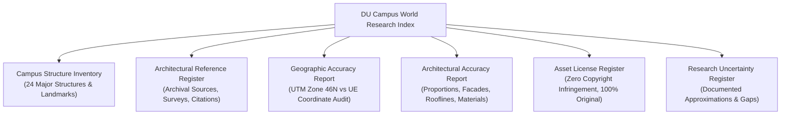

# UNIVERSITY OF DHAKA — WORLD RESEARCH & ARCHITECTURAL ACCURACY INDEX
## Level 1: "Where It All Began" (July 1–14, 2024)
### Project SparkVision | Unreal Engine 5.8 Game World Development

---

## 1. Executive Mission & Environmental Context

This research index establishes the empirical and architectural authority for the **Level 1** game world of **SparkVision**, titled **"Where It All Began"**. Set during the critical early days of the July 2024 student movement (July 1–14, 2024), the Level 1 environment reconstructs the historic **University of Dhaka (DU)** campus in Dhaka, Bangladesh.

The primary story and gameplay precinct is centered upon **Curzon Hall** and its adjacent science quadrangle, expanding outward into an explorable semi-open-world environment spanning the historic academic and student corridors of Dhaka University:
* **Sector 1**: Curzon & Science Precinct (Curzon Hall, Botanical Pond, Science Annexes, Dr. Muhammad Shahidullah Hall)
* **Sector 2**: University Avenue & Doyel Chattar (Doyel Monument Roundabout, Bangla Academy / Burdwan House, Suhrawardy Canopy)
* **Sector 3**: Memorial & Residential Corridor (Central Shaheed Minar, Fuller Road Boulevard, Salimullah Muslim Hall, Jagannath Hall, Begum Rokeya Hall)
* **Sector 4**: TSC & Central Library Precinct (Teacher-Student Centre by Constantinos Doxiadis, Anti-Terrorism Raju Memorial Sculpture, Muzharul Islam Central Library, Hakim Chattar, DU Central Mosque, Kazi Nazrul Islam Mausoleum)
* **Sector 5**: Arts, Social Sciences & Western Quad (Arts Faculty / Kala Bhaban, Syed Abdullah Khalid's Aparajeyo Bangla, Administrative Registrar Building, Masterda Surja Sen Hall, Haji Muhammad Mohsin Hall)
* **Sector 6**: Distant Urban Periphery (Shahbagh, High Court Mughal perimeter, Nilkhet educational boundary, Old Dhaka skyline)

---

## 2. Research & World Development Register Overview

| Document | Primary Focus | File Path |
| :--- | :--- | :--- |
| **Structure Inventory** | Exhaustive survey of all 24 campus buildings, footprints, heights, styles, and in-engine actor bindings | [`Campus_Structure_Inventory.md`](file:///Users/atiaoishi/Downloads/sparkvision/Documentation/WorldResearch/Campus_Structure_Inventory.md) |
| **Reference Register** | Archival surveys, official DU records, photographic documentation, and verified citations | [`Architectural_Reference_Register.md`](file:///Users/atiaoishi/Downloads/sparkvision/Documentation/WorldResearch/Architectural_Reference_Register.md) |
| **Geographic Accuracy** | 1:1 Metric UTM Zone 46N coordinate verification, bearing audits, and spatial network validation | [`Geographic_Accuracy_Report.md`](file:///Users/atiaoishi/Downloads/sparkvision/Documentation/WorldResearch/Geographic_Accuracy_Report.md) |
| **Architectural Accuracy** | Detailed structural verification of hero landmarks, Indo-Saracenic and Tropical Modernist analysis | [`Architectural_Accuracy_Report.md`](file:///Users/atiaoishi/Downloads/sparkvision/Documentation/WorldResearch/Architectural_Accuracy_Report.md) |
| **Asset Licensing** | Compliance audit confirming 100% original geometry, PBR material creation, and zero proprietary IP use | [`Asset_License_Register.md`](file:///Users/atiaoishi/Downloads/sparkvision/Documentation/WorldResearch/Asset_License_Register.md) |
| **Uncertainty Register** | Transparent documentation of historical data limits, modern modifications, and verified reconstructions | [`Research_Uncertainty_Register.md`](file:///Users/atiaoishi/Downloads/sparkvision/Documentation/WorldResearch/Research_Uncertainty_Register.md) |

---

## 3. World Space Classifications

To balance expansive semi-open-world immersion with high runtime performance on Apple Silicon (16 GB unified RAM), campus zones are categorized into five distinct functional tiers:

1. **Playable Areas**:
   - Curzon Hall South Promenade, Grand Colonnade, and Central Arcade.
   - Curzon Botanical Pond ghat steps and courtyard lawn.
   - Primary arterial road corridor connecting Curzon to Doyel Chattar and Shaheed Minar.
   - TSC Mor and Raju Memorial gathering plaza.
   - Central Library approach ramp and Hakim Chattar.
   - Aparajeyo Bangla plaza in front of Kala Bhaban.
   - *Requirements*: 100% solid collision, detailed PBR micro-textures, interactive student archives, physical NPC navigation.

2. **Visible Restricted Areas**:
   - Interiors of departmental laboratories (Physics, Chemistry Annexes).
   - Residential room blocks of student halls (Shahidullah, Salimullah, Jagannath, Surja Sen, Mohsin).
   - Administrative offices inside Registrar Bhaban.
   - *Requirements*: High visual facade detail, believable window glass and interior depth cues, perimeter collision blocking entry to unfinished interiors.

3. **Scenic Background Areas**:
   - Distant perimeter urban skyline meshes (Shahbagh, Nilkhet, Ramna, Old Dhaka).
   - Dense Suhrawardy Udyan deep forest canopy.
   - *Requirements*: Low-poly silhouette representation, optimized material instances, horizon atmospheric depth.

4. **Story-Restricted Areas**:
   - Dhaka Medical College emergency approach corridors.
   - Nilkhet book market barricade zones.
   - *Requirements*: Visible from campus road boundaries, barrier gates and railings to be unlocked in subsequent chapters (Chapters 2–6).

5. **Hero Landmarks**:
   - Curzon Hall Complex (1904 Indo-Saracenic)
   - Central Shaheed Minar (1952/1963 Memorial Altar)
   - Teacher-Student Centre (1961 Tropical Modernist Pavilion)
   - Anti-Terrorism Raju Memorial Sculpture (1997 Bronze Figure Circle)
   - Muzharul Islam Central Library (1953 Concrete Brise-Soleil)
   - Aparajeyo Bangla (1979 Liberation War Concrete Trio)
   - Doyel Chattar Monument (National Bird Fountain)
   - DU Central Mosque & Kazi Nazrul Islam Mausoleum
   - *Requirements*: Custom bespoke static meshes, authentic historical silhouettes, multi-tier PBR materials, rigorous photo-matching.

---

## 4. Architectural & Aesthetic Direction

The environmental quality standard takes inspiration from the atmospheric depth, natural lighting, wind-swept foliage, and material richness of **Where Winds Meet** and **Ghost of Tsushima**, while strictly preserving the **authentic geographic and cultural identity of the University of Dhaka**:
* **Climate & Season**: Mid-July tropical monsoon daylight. High ambient humidity, soft distance haze, warm sunlight (65,000 Lux, 5600K) puncturing broken cumulus clouds.
* **Palette**: Red-oxide colonial brick, weathered chuna-surki plaster, patinated bronze, monsoon-washed white marble, lush tropical vegetation (deep green Banyan, Raintree, and vibrant Krishnachura canopies).
* **Integrity**: Zero generic fantasy elements, zero fictional east-asian temple motifs. Every arch, column, louver, and plinth directly reflects documented Bangladeshi architectural history.
